# Reliability-Weighted Multimodal AI for Early Autism Risk Screening: comparison of ten hybrid deep-learning architectures

BITE308L Artificial Intelligence (VIT) - project results report. Team: Samith Kolur (24BIT0117), Iniya K, Chandru Vel Kumar.

> Screening-support research only. No result in this report is a diagnosis or an estimate of clinical accuracy.

## 1. Abstract

We trained and compared ten hybrid deep-learning architectures (a pretrained or custom-CNN spatial encoder, a recurrent or Transformer temporal encoder and an attention head) for autism risk screening on two public datasets: eye-tracking recordings of 57 children (D01) and 2,940 web-collected facial images (D02). All models used one fixed training protocol and grouped 10-fold cross-validation; tabular baselines were run on three questionnaire datasets. On D01, child-level pooled ROC-AUC ranged from 0.574 to 0.832, but a logistic regression on three recording-quality features alone reached 0.823. No model was significantly better than this baseline, and only one model (M07) had a matched-subset AUC whose 95% bootstrap CI excluded 0.5 (0.724 [0.551, 0.883], 14 matched pairs); the other models' matched AUCs had CIs including 0.5. On D02, models reached mean ROC-AUCs of 0.867-0.931, yet simple non-facial image statistics alone reached 0.796, so dataset artefacts separate the classes. Removing near-duplicate test images changed AUCs by at most 0.002. Pretrained encoders scored higher on average than custom CNNs on both datasets. The results do not show that the models learned autism-related gaze or facial patterns and are not clinical accuracy estimates; they motivate fusion that weights each modality by its estimated reliability.

## 2. Objective

Implement the ten hybrid architectures suggested by our faculty, train and evaluate them with the same protocol and 10-fold cross-validation on a local GPU, and compare them on an eye-tracking dataset (primary) and a facial-image dataset (secondary), with tabular screening questionnaires as non-deep baselines. A second objective, added after the first results, was to test whether the models' performance can be explained by shortcuts in the data (recording quality, image artefacts, near-duplicate images) rather than by autism-related patterns.

## 3. Datasets

| dataset | source_folder | modality | sample_unit | n (pos / neg) | groups | role | exclusions |
|---|---|---|---|---|---|---|---|
| D01_eye_tracking | Eye-Tracking Dataset | eye-tracking gaze time series -> clips of 8 x 1-s gaze images | clip | 1,241 (437 / 804) | 57 children (27 ASD / 30 TD) | PRIMARY: 10 hybrid models | IDs 12, 16 have no gaze rows; rows without participant ID ('Unidentified', ~40%) dropped; cross-file duplicate rows removed (DD-02); CARS score never used (label proxy, DD-03) |
| D02_facial_images_A | DFDK facial images (AutismDataset sub-folder) | facial RGB images | image | 2,940 (1,470 / 1,470) | 2,929 near-duplicate groups | SECONDARY: 10 hybrid models | original train/valid/test folders pooled (DD-05); pHash <= 4 pairs grouped (DD-07) |
| D04_autism_prediction | Autism_prediction dataset (train.csv) | screening questionnaire table | row | 800 (161 / 639) | 800 duplicate-feature groups | tabular baselines | test.csv has no labels -> unused (DD-08) |
| D05_toddler_screening | Autism_dataset (Toddler Autism dataset July 2018.csv) | toddler screening questionnaire | row | 1,054 (728 / 326) | 975 duplicate-feature groups | tabular baselines (set_all = label-definitional upper bound; set_honest without A1-A10 / Qchat score) | label = (A1..A10 sum >= 4) (DD-09); Autism_Screening_Data_Combined.csv EXCLUDED: it embeds the toddler file with 728 labels changed |
| D06_early_autism | early_autism (asd.csv) | screening table | row | 1,000 (411 / 589) | 1,000 duplicate-feature groups | tabular baselines | empty column 'Unnamed: 10' dropped (DD-10) |
| D03_facial_images_B | AutismDataset | facial RGB images | image | 2,940 (1,470 / 1,470) | - | EXCLUDED | copy of D02: 2,541 byte-identical + 399 re-saved images (DD-06) |

Sources: `results/final/datasets_table.csv` (counts from the frozen split files); full decisions in `data_registry/DATASET_DECISIONS.md` (DD-01 ... DD-12). No datasets are merged and no predictions are combined across datasets (DD-11).

## 4. Methods

### 4.1 Preprocessing

- **D01**: gaze rows without a participant ID were dropped and cross-file duplicate rows removed before any windowing; recordings were split at gaps > 500 ms; each clip = 8 consecutive non-overlapping 1-s windows with at least 50% valid gaze, each window rendered as a 3-channel 224 x 224 image (scan path, fixation density, time); at most 40 clips per child. Child score = mean clip probability. Per-child tracking-quality features (valid ratio, blink ratio, tracking ratio) were stored separately and never used as model inputs.
- **D02**: images resized to 224 and centre-cropped; training-only augmentation (random resized crop 0.8-1.0, horizontal flip, colour jitter 0.1). Images with pHash Hamming distance <= 4 form one group.
- **Tabular (D04-D06)**: imputers, encoders and scalers fit on each fold's training part only.

### 4.2 The ten architectures

Shared design: per-step spatial encoder -> linear projection -> temporal encoder -> attention pooling (MLP head for M05, mean pooling for M10) -> classifier -> P(ASD). D01 sequences run over time (8 one-second images); D02 sequences run over spatial tokens of the encoder's final feature map (49, or 196 for ViT and the custom CNN). Custom CNN = 4 x [Conv3x3-BN-ReLU-MaxPool], 32-64-128-256 channels, random initialisation.

| id | architecture | spatial encoder (timm weights) | temporal encoder | head |
|---|---|---|---|---|
| M01 | EfficientNetB3 + BiLSTM + Attn | EfficientNet-B3 (efficientnet_b3.ra2_in1k) | BiLSTM | temporal attention |
| M02 | CNN + BiLSTM + Attn | custom CNN (from scratch) | BiLSTM | temporal attention |
| M03 | ResNet50 + LSTM + Attn | ResNet-50 (resnet50.a1_in1k) | LSTM | temporal attention |
| M04 | ConvNeXt + BiLSTM + Attn | ConvNeXt-Tiny (convnext_tiny.in12k_ft_in1k) | BiLSTM | temporal attention |
| M05 | CNN + Transformer + MLP | custom CNN (from scratch) | Transformer encoder | MLP head |
| M06 | DenseNet121 + LSTM + Attn | DenseNet-121 (densenet121.ra_in1k) | LSTM | temporal attention |
| M07 | ViT + LSTM + Attn | ViT-B/16 (vit_base_patch16_224.augreg2_in21k_ft_in1k) | LSTM | temporal attention |
| M08 | EfficientNet + Transformer + Attn | EfficientNet-B0 (efficientnet_b0.ra_in1k) | Transformer encoder | temporal attention |
| M09 | CNN + GRU + Attn | custom CNN (from scratch) | GRU | temporal attention |
| M10 | ResNet50 + BiLSTM + Transformer | ResNet-50 (resnet50.a1_in1k) | BiLSTM -> Transformer | mean pooling |

### 4.3 Fixed training protocol (no tuning on test data)

AdamW (weight decay 0.01); head learning rate 5e-4 for pretrained models and 1e-3 for custom CNNs; D01 pretrained backbones frozen (cached features), D02 pretrained backbones fine-tune their last stage at lr/10, custom CNNs train fully; cosine schedule with 2-epoch warm-up; at most 40 epochs; early stopping on validation ROC-AUC (patience 8); class-weighted BCE; gradient clipping 1.0; mixed precision; batch size 64; seed 42 + fold. Thresholds: 0.5 and Youden J on the validation part. Hardware: one NVIDIA RTX A2000 12 GB.

### 4.4 Cross-validation and leakage controls

Outer StratifiedGroupKFold(10, shuffle, seed 42) by group (D01 child, D02 near-duplicate group, tabular identical-feature-row group); the validation part = one group-wise split of the training groups (about 15%). Splits were made once, hashed, and verified before every run; every run asserted that no test id appeared in a training or validation batch; test folds were predicted once from the best validation checkpoint and never used for any choice. All ten models were checked to predict exactly the same test ids in every fold.

### 4.5 Statistics and shortcut controls

Pooled out-of-fold AUC with 95% bootstrap CIs (2,000 resamples, seed 42, stratified, resampling children / near-duplicate groups / feature groups); Friedman test on the 10 x 10 fold-AUC matrix with Nemenyi post-hoc and critical-difference diagrams; Nadeau-Bengio corrected resampled t-test (best vs each, Holm-adjusted); Brier score and expected calibration error (10 bins). Shortcut controls (Stage 8, no retraining): D01 quality-only baselines on the same folds, paired bootstrap and DeLong comparison, Spearman dependence, quality tertiles, 1:1 quality matching (caliper 0.05) and an exploratory incremental-value analysis; D02 near-duplicate sensitivity (pHash <= 8), an image-statistics baseline (17 non-facial features, logistic regression and random forest) and an original-split analysis.

## 5. Results per dataset

All values: `results/final/master_table.csv` (every number has a `__source` column). ROC-AUC ... Brier = mean ± std over the 10 test folds at threshold 0.5; pooled AUC = one AUC over all out-of-fold predictions.

### 5.1 D01 eye-tracking

Clip level (1,241 clips): pooled AUC 0.541-0.689; child level (57 children): 0.574-0.832 (Figure F2). The tracking-quality-only baseline reaches 0.823 [0.701, 0.928] at child level (section 6).

Clip level:

| model | ROC-AUC | pooled AUC [95% CI] | PR-AUC | bal. acc. | sens. | spec. | F1 | Brier | ECE |
|---|---|---|---|---|---|---|---|---|---|
| M08 EfficientNet + Transformer + Attn | 0.686 ± 0.128 | 0.689 [0.594, 0.781] | 0.572 ± 0.154 | 0.605 ± 0.092 | 0.503 ± 0.249 | 0.707 ± 0.177 | 0.485 ± 0.164 | 0.218 ± 0.056 | 0.121 |
| M04 ConvNeXt + BiLSTM + Attn | 0.683 ± 0.081 | 0.657 [0.560, 0.747] | 0.589 ± 0.129 | 0.614 ± 0.057 | 0.552 ± 0.193 | 0.676 ± 0.219 | 0.501 ± 0.101 | 0.227 ± 0.042 | 0.113 |
| M07 ViT + LSTM + Attn | 0.678 ± 0.099 | 0.675 [0.610, 0.745] | 0.567 ± 0.158 | 0.630 ± 0.092 | 0.522 ± 0.183 | 0.738 ± 0.096 | 0.493 ± 0.150 | 0.221 ± 0.031 | 0.096 |
| M05 CNN + Transformer + MLP | 0.657 ± 0.115 | 0.610 [0.456, 0.748] | 0.523 ± 0.152 | 0.543 ± 0.059 | 0.481 ± 0.385 | 0.605 ± 0.366 | 0.380 ± 0.221 | 0.276 ± 0.079 | 0.238 |
| M01 EfficientNetB3 + BiLSTM + Attn | 0.645 ± 0.108 | 0.634 [0.544, 0.717] | 0.538 ± 0.171 | 0.588 ± 0.083 | 0.484 ± 0.130 | 0.692 ± 0.206 | 0.470 ± 0.118 | 0.247 ± 0.063 | 0.146 |
| M06 DenseNet121 + LSTM + Attn | 0.639 ± 0.108 | 0.652 [0.576, 0.728] | 0.522 ± 0.175 | 0.596 ± 0.083 | 0.481 ± 0.157 | 0.710 ± 0.143 | 0.465 ± 0.122 | 0.234 ± 0.050 | 0.125 |
| M10 ResNet50 + BiLSTM + Transformer | 0.638 ± 0.134 | 0.628 [0.509, 0.746] | 0.521 ± 0.162 | 0.573 ± 0.096 | 0.557 ± 0.319 | 0.589 ± 0.343 | 0.455 ± 0.144 | 0.262 ± 0.060 | 0.195 |
| M03 ResNet50 + LSTM + Attn | 0.635 ± 0.107 | 0.625 [0.542, 0.707] | 0.508 ± 0.128 | 0.579 ± 0.090 | 0.416 ± 0.131 | 0.741 ± 0.203 | 0.424 ± 0.128 | 0.245 ± 0.061 | 0.115 |
| M09 CNN + GRU + Attn | 0.605 ± 0.087 | 0.541 [0.398, 0.693] | 0.501 ± 0.127 | 0.518 ± 0.026 | 0.726 ± 0.385 | 0.310 ± 0.423 | 0.438 ± 0.170 | 0.411 ± 0.173 | 0.405 |
| M02 CNN + BiLSTM + Attn | 0.595 ± 0.134 | 0.570 [0.426, 0.700] | 0.488 ± 0.166 | 0.513 ± 0.059 | 0.773 ± 0.288 | 0.253 ± 0.338 | 0.449 ± 0.141 | 0.333 ± 0.101 | 0.302 |

Child level:

| model | ROC-AUC | pooled AUC [95% CI] | PR-AUC | bal. acc. | sens. | spec. | F1 | Brier | ECE |
|---|---|---|---|---|---|---|---|---|---|
| M04 ConvNeXt + BiLSTM + Attn | 0.856 ± 0.137 | 0.762 [0.628, 0.883] | 0.893 ± 0.095 | 0.675 ± 0.121 | 0.617 ± 0.236 | 0.733 ± 0.378 | 0.642 ± 0.120 | 0.208 ± 0.037 | 0.164 |
| M08 EfficientNet + Transformer + Attn | 0.828 ± 0.210 | 0.786 [0.658, 0.895] | 0.877 ± 0.166 | 0.717 ± 0.143 | 0.600 ± 0.251 | 0.833 ± 0.283 | 0.649 ± 0.253 | 0.190 ± 0.038 | 0.121 |
| M07 ViT + LSTM + Attn | 0.800 ± 0.219 | 0.832 [0.722, 0.927] | 0.879 ± 0.130 | 0.758 ± 0.186 | 0.617 ± 0.334 | 0.900 ± 0.161 | 0.666 ± 0.313 | 0.188 ± 0.047 | 0.158 |
| M06 DenseNet121 + LSTM + Attn | 0.783 ± 0.207 | 0.784 [0.656, 0.895] | 0.859 ± 0.126 | 0.675 ± 0.133 | 0.617 ± 0.236 | 0.733 ± 0.263 | 0.637 ± 0.157 | 0.197 ± 0.040 | 0.116 |
| M05 CNN + Transformer + MLP | 0.767 ± 0.187 | 0.605 [0.443, 0.756] | 0.814 ± 0.166 | 0.575 ± 0.127 | 0.550 ± 0.416 | 0.600 ± 0.466 | 0.470 ± 0.329 | 0.266 ± 0.070 | 0.217 |
| M10 ResNet50 + BiLSTM + Transformer | 0.761 ± 0.193 | 0.673 [0.521, 0.809] | 0.827 ± 0.144 | 0.617 ± 0.177 | 0.567 ± 0.446 | 0.667 ± 0.471 | 0.497 ± 0.365 | 0.231 ± 0.057 | 0.119 |
| M01 EfficientNetB3 + BiLSTM + Attn | 0.761 ± 0.219 | 0.714 [0.569, 0.840] | 0.828 ± 0.178 | 0.692 ± 0.201 | 0.550 ± 0.352 | 0.833 ± 0.283 | 0.573 ± 0.351 | 0.219 ± 0.038 | 0.195 |
| M03 ResNet50 + LSTM + Attn | 0.744 ± 0.195 | 0.735 [0.604, 0.852] | 0.847 ± 0.116 | 0.675 ± 0.114 | 0.517 ± 0.277 | 0.833 ± 0.324 | 0.567 ± 0.229 | 0.211 ± 0.049 | 0.145 |
| M09 CNN + GRU + Attn | 0.706 ± 0.203 | 0.574 [0.427, 0.725] | 0.794 ± 0.151 | 0.500 ± 0.000 | 0.767 ± 0.417 | 0.233 ± 0.417 | 0.505 ± 0.270 | 0.357 ± 0.091 | 0.366 |
| M02 CNN + BiLSTM + Attn | 0.678 ± 0.283 | 0.578 [0.425, 0.731] | 0.769 ± 0.216 | 0.483 ± 0.053 | 0.833 ± 0.324 | 0.133 ± 0.322 | 0.545 ± 0.200 | 0.285 ± 0.070 | 0.244 |

Descriptive attention (F9, M07): the mean attention weight on the last second of the clip is 0.172 ± 0.019 for ASD and 0.141 ± 0.010 for TD children (uniform = 0.125); on the first second 0.104 vs 0.123. Attention weights are not explanations and were not tested.

### 5.2 D02 facial images

Mean ROC-AUC 0.867-0.931; highest mean fold AUC M04 (0.931), highest pooled AUC M07 (0.898 [0.887, 0.909]) (F5, F6). The pooled AUC is lower than the mean fold AUC for most models, consistent with the ten fold models not sharing one probability scale (Stage 6).

| model | ROC-AUC | pooled AUC [95% CI] | PR-AUC | bal. acc. | sens. | spec. | F1 | Brier | ECE |
|---|---|---|---|---|---|---|---|---|---|
| M04 ConvNeXt + BiLSTM + Attn | 0.931 ± 0.015 | 0.896 [0.884, 0.908] | 0.931 ± 0.016 | 0.845 ± 0.028 | 0.848 ± 0.074 | 0.841 ± 0.095 | 0.845 ± 0.026 | 0.131 ± 0.023 | 0.097 |
| M07 ViT + LSTM + Attn | 0.924 ± 0.015 | 0.898 [0.887, 0.909] | 0.919 ± 0.019 | 0.832 ± 0.033 | 0.816 ± 0.085 | 0.848 ± 0.060 | 0.827 ± 0.042 | 0.136 ± 0.031 | 0.099 |
| M08 EfficientNet + Transformer + Attn | 0.903 ± 0.011 | 0.871 [0.857, 0.884] | 0.896 ± 0.014 | 0.819 ± 0.028 | 0.807 ± 0.036 | 0.831 ± 0.063 | 0.817 ± 0.025 | 0.152 ± 0.019 | 0.121 |
| M01 EfficientNetB3 + BiLSTM + Attn | 0.901 ± 0.021 | 0.882 [0.870, 0.894] | 0.893 ± 0.020 | 0.812 ± 0.024 | 0.789 ± 0.060 | 0.834 ± 0.034 | 0.806 ± 0.031 | 0.155 ± 0.030 | 0.130 |
| M06 DenseNet121 + LSTM + Attn | 0.901 ± 0.011 | 0.885 [0.873, 0.897] | 0.897 ± 0.016 | 0.811 ± 0.022 | 0.790 ± 0.047 | 0.832 ± 0.065 | 0.807 ± 0.021 | 0.144 ± 0.017 | 0.094 |
| M03 ResNet50 + LSTM + Attn | 0.890 ± 0.010 | 0.882 [0.870, 0.894] | 0.883 ± 0.013 | 0.804 ± 0.014 | 0.776 ± 0.027 | 0.832 ± 0.041 | 0.799 ± 0.012 | 0.147 ± 0.012 | 0.084 |
| M10 ResNet50 + BiLSTM + Transformer | 0.885 ± 0.016 | 0.875 [0.862, 0.887] | 0.880 ± 0.017 | 0.789 ± 0.030 | 0.721 ± 0.096 | 0.856 ± 0.051 | 0.771 ± 0.048 | 0.164 ± 0.024 | 0.123 |
| M05 CNN + Transformer + MLP | 0.881 ± 0.016 | 0.874 [0.862, 0.887] | 0.866 ± 0.020 | 0.795 ± 0.022 | 0.807 ± 0.081 | 0.783 ± 0.077 | 0.797 ± 0.028 | 0.147 ± 0.017 | 0.062 |
| M09 CNN + GRU + Attn | 0.875 ± 0.028 | 0.867 [0.855, 0.880] | 0.860 ± 0.025 | 0.778 ± 0.042 | 0.776 ± 0.073 | 0.780 ± 0.120 | 0.778 ± 0.033 | 0.157 ± 0.021 | 0.080 |
| M02 CNN + BiLSTM + Attn | 0.867 ± 0.046 | 0.869 [0.855, 0.882] | 0.853 ± 0.051 | 0.785 ± 0.039 | 0.787 ± 0.052 | 0.784 ± 0.083 | 0.786 ± 0.034 | 0.153 ± 0.023 | 0.067 |

### 5.3 Tabular baselines (D04, D05, D06)

Best pooled AUC (dummy excluded): D04 mlp 0.905 [0.882, 0.926]; D05 set_honest hist_gb 0.610 [0.570, 0.652]; D06 logreg 0.482 [0.446, 0.519] (no model above chance); D05 set_all 1.000 is label-definitional (the label is a rule on the A1-A10 items, which are features in this set) (F10).

D04:

| model | ROC-AUC | pooled AUC [95% CI] | PR-AUC | bal. acc. | sens. | spec. | F1 | Brier | ECE |
|---|---|---|---|---|---|---|---|---|---|
| mlp | 0.912 ± 0.031 | 0.905 [0.882, 0.926] | 0.714 ± 0.096 | 0.773 ± 0.067 | 0.628 ± 0.164 | 0.917 ± 0.061 | 0.634 ± 0.106 | 0.096 ± 0.014 | 0.018 |
| logreg | 0.905 ± 0.040 | 0.899 [0.872, 0.921] | 0.717 ± 0.082 | 0.832 ± 0.037 | 0.839 ± 0.052 | 0.826 ± 0.069 | 0.669 ± 0.073 | 0.123 ± 0.036 | 0.107 |
| random_forest | 0.900 ± 0.041 | 0.901 [0.875, 0.922] | 0.653 ± 0.126 | 0.762 ± 0.036 | 0.596 ± 0.055 | 0.928 ± 0.044 | 0.637 ± 0.074 | 0.100 ± 0.018 | 0.043 |
| hist_gb | 0.881 ± 0.036 | 0.880 [0.852, 0.905] | 0.631 ± 0.112 | 0.783 ± 0.036 | 0.683 ± 0.082 | 0.884 ± 0.052 | 0.640 ± 0.058 | 0.124 ± 0.029 | 0.096 |
| dummy_majority | 0.500 ± 0.000 | 0.500 [0.500, 0.500] | 0.201 ± 0.004 | 0.500 ± 0.000 | 0.000 ± 0.000 | 1.000 ± 0.000 | 0.000 ± 0.000 | 0.201 ± 0.004 | 0.201 |

D05 set_all:

| model | ROC-AUC | pooled AUC [95% CI] | PR-AUC | bal. acc. | sens. | spec. | F1 | Brier | ECE |
|---|---|---|---|---|---|---|---|---|---|
| logreg | 1.000 ± 0.000 | 1.000 [1.000, 1.000] | 1.000 ± 0.000 | 1.000 ± 0.000 | 1.000 ± 0.000 | 1.000 ± 0.000 | 1.000 ± 0.000 | 0.003 ± 0.001 | 0.022 |
| random_forest | 1.000 ± 0.000 | 1.000 [1.000, 1.000] | 1.000 ± 0.000 | 1.000 ± 0.000 | 1.000 ± 0.000 | 1.000 ± 0.000 | 1.000 ± 0.000 | 0.004 ± 0.001 | 0.036 |
| hist_gb | 1.000 ± 0.000 | 1.000 [1.000, 1.000] | 1.000 ± 0.000 | 1.000 ± 0.000 | 1.000 ± 0.000 | 1.000 ± 0.000 | 1.000 ± 0.000 | 0.000 ± 0.000 | 0.000 |
| mlp | 0.999 ± 0.003 | 0.999 [0.998, 1.000] | 0.999 ± 0.001 | 0.978 ± 0.028 | 0.995 ± 0.010 | 0.961 ± 0.054 | 0.989 ± 0.013 | 0.023 ± 0.016 | 0.063 |
| dummy_majority | 0.500 ± 0.000 | 0.500 [0.500, 0.500] | 0.691 ± 0.004 | 0.500 ± 0.000 | 1.000 ± 0.000 | 0.000 ± 0.000 | 0.817 ± 0.003 | 0.309 ± 0.004 | 0.309 |

D05 set_honest:

| model | ROC-AUC | pooled AUC [95% CI] | PR-AUC | bal. acc. | sens. | spec. | F1 | Brier | ECE |
|---|---|---|---|---|---|---|---|---|---|
| random_forest | 0.612 ± 0.070 | 0.607 [0.564, 0.650] | 0.765 ± 0.049 | 0.563 ± 0.062 | 0.696 ± 0.094 | 0.429 ± 0.102 | 0.711 ± 0.062 | 0.250 ± 0.034 | 0.186 |
| hist_gb | 0.612 ± 0.074 | 0.610 [0.570, 0.652] | 0.772 ± 0.054 | 0.573 ± 0.073 | 0.618 ± 0.094 | 0.527 ± 0.097 | 0.673 ± 0.071 | 0.248 ± 0.032 | 0.178 |
| mlp | 0.597 ± 0.069 | 0.587 [0.546, 0.627] | 0.758 ± 0.043 | 0.538 ± 0.043 | 0.948 ± 0.056 | 0.129 ± 0.108 | 0.810 ± 0.025 | 0.214 ± 0.018 | 0.037 |
| logreg | 0.594 ± 0.068 | 0.591 [0.544, 0.637] | 0.762 ± 0.044 | 0.577 ± 0.062 | 0.661 ± 0.053 | 0.494 ± 0.114 | 0.700 ± 0.041 | 0.242 ± 0.010 | 0.178 |
| dummy_majority | 0.500 ± 0.000 | 0.500 [0.500, 0.500] | 0.691 ± 0.004 | 0.500 ± 0.000 | 1.000 ± 0.000 | 0.000 ± 0.000 | 0.817 ± 0.003 | 0.309 ± 0.004 | 0.309 |

D06:

| model | ROC-AUC | pooled AUC [95% CI] | PR-AUC | bal. acc. | sens. | spec. | F1 | Brier | ECE |
|---|---|---|---|---|---|---|---|---|---|
| dummy_majority | 0.500 ± 0.000 | 0.500 [0.500, 0.500] | 0.411 ± 0.003 | 0.500 ± 0.000 | 0.000 ± 0.000 | 1.000 ± 0.000 | 0.000 ± 0.000 | 0.411 ± 0.003 | 0.411 |
| logreg | 0.481 ± 0.065 | 0.482 [0.446, 0.519] | 0.428 ± 0.058 | 0.503 ± 0.057 | 0.501 ± 0.096 | 0.504 ± 0.070 | 0.451 ± 0.071 | 0.253 ± 0.005 | 0.098 |
| random_forest | 0.466 ± 0.051 | 0.466 [0.429, 0.502] | 0.417 ± 0.029 | 0.503 ± 0.037 | 0.273 ± 0.073 | 0.733 ± 0.046 | 0.326 ± 0.069 | 0.270 ± 0.012 | 0.146 |
| hist_gb | 0.459 ± 0.039 | 0.460 [0.422, 0.494] | 0.400 ± 0.031 | 0.472 ± 0.037 | 0.397 ± 0.086 | 0.547 ± 0.055 | 0.385 ± 0.060 | 0.312 ± 0.017 | 0.228 |
| mlp | 0.449 ± 0.064 | 0.468 [0.432, 0.504] | 0.417 ± 0.048 | 0.498 ± 0.026 | 0.143 ± 0.165 | 0.853 ± 0.190 | 0.168 ± 0.165 | 0.249 ± 0.005 | 0.087 |

### 5.4 Confusion matrices and calibration of the best model per dataset

| dataset | model | TN | FP | FN | TP | ECE |
|---|---|---|---|---|---|---|
| D01 clip | M08 | 572 | 232 | 195 | 242 | 0.121 |
| D01 child | M07 | 27 | 3 | 10 | 17 | 0.158 |
| D02 | M07 | 1246 | 224 | 271 | 1199 | 0.099 |
| D04 | mlp | 586 | 53 | 60 | 101 | 0.018 |
| D05 set_all | logreg | 326 | 0 | 0 | 728 | 0.022 |
| D05 set_honest | hist_gb | 172 | 154 | 278 | 450 | 0.178 |
| D06 | logreg | 297 | 292 | 205 | 206 | 0.098 |

Pooled out-of-fold, threshold 0.5 (F8, F12; `results/final/confusion_matrices_best.csv`). ECE ranges over the 10 deep models: D01 clip 0.096-0.405, D01 child 0.116-0.366, D02 0.062-0.130.

## 6. Shortcut analysis

### 6.1 D01: tracking quality

Quality-only baselines on the same folds: logistic regression on three quality features 0.823 [0.701, 0.928]; 1 - mean valid ratio 0.842 (direction noticed after looking at the data, optimistic); clip level 0.678. Matching on mean valid ratio left 14 ASD-TD pairs (standardised mean difference -1.33 -> -0.16). Figures F2-F4.

| model | child AUC [95% CI] | diff vs quality LR3 [95% CI] | DeLong p | matched AUC [95% CI] | Spearman rho (all / ASD / TD) | adds information (rule) |
|---|---|---|---|---|---|---|
| M01 | 0.714 [0.569, 0.840] | -0.110 [-0.265, +0.046] | 0.161 | 0.556 [0.337, 0.765] | -0.44 / -0.48 / -0.09 | no |
| M02 | 0.578 [0.425, 0.731] | -0.246 [-0.417, -0.084] | 0.003 | 0.469 [0.281, 0.663] | -0.30 / -0.42 / -0.07 | no |
| M03 | 0.735 [0.604, 0.852] | -0.089 [-0.233, +0.054] | 0.230 | 0.587 [0.362, 0.796] | -0.54 / -0.50 / -0.32 | no |
| M04 | 0.762 [0.628, 0.883] | -0.062 [-0.196, +0.069] | 0.351 | 0.592 [0.337, 0.816] | -0.56 / -0.53 / -0.15 | no |
| M05 | 0.605 [0.443, 0.756] | -0.219 [-0.398, -0.058] | 0.008 | 0.515 [0.311, 0.709] | -0.32 / -0.38 / -0.16 | no |
| M06 | 0.784 [0.656, 0.895] | -0.040 [-0.151, +0.065] | 0.478 | 0.597 [0.367, 0.781] | -0.71 / -0.71 / -0.36 | no |
| M07 | 0.832 [0.722, 0.927] | +0.009 [-0.098, +0.120] | 0.876 | 0.724 [0.551, 0.883] | -0.67 / -0.66 / -0.31 | yes |
| M08 | 0.786 [0.658, 0.895] | -0.037 [-0.174, +0.107] | 0.590 | 0.679 [0.469, 0.842] | -0.59 / -0.60 / -0.30 | no |
| M09 | 0.574 [0.427, 0.725] | -0.249 [-0.410, -0.090] | 0.002 | 0.536 [0.316, 0.755] | -0.27 / -0.60 / +0.12 | no |
| M10 | 0.673 [0.521, 0.809] | -0.151 [-0.295, -0.007] | 0.036 | 0.551 [0.347, 0.750] | -0.46 / -0.57 / -0.12 | no |

Every model's child score is negatively correlated with the mean valid ratio; 4 models (M02, M05, M09, M10) are significantly worse than the quality-only baseline and none is significantly better.

### 6.2 D02: image artefacts and near-duplicates

An image-statistics baseline that never sees a face (size, aspect ratio, file size, JPEG quality, colour and brightness statistics, border colour, sharpness) reaches mean AUC 0.796 (random forest) and 0.782 (logistic regression): dataset artefacts alone separate the classes. Removing the 65 test images with a pHash <= 8 neighbour in the fold's training images changes model AUCs by -0.002 to -0.001. All models score higher on the images of the original 'test' folder than on the rest (F5, F6).

| model | pooled AUC [95% CI] | fold-mean AUC | fold-mean AUC, near-dups removed | change | orig 'test' - rest [95% CI] |
|---|---|---|---|---|---|
| M01 | 0.882 [0.870, 0.894] | 0.901 | 0.899 | -0.002 | +0.020 [-0.022, +0.054] |
| M02 | 0.869 [0.855, 0.882] | 0.867 | 0.865 | -0.002 | +0.040 [+0.001, +0.075] |
| M03 | 0.882 [0.870, 0.894] | 0.890 | 0.889 | -0.002 | +0.028 [-0.009, +0.061] |
| M04 | 0.896 [0.884, 0.908] | 0.931 | 0.929 | -0.002 | +0.050 [+0.018, +0.079] |
| M05 | 0.874 [0.862, 0.887] | 0.881 | 0.879 | -0.002 | +0.027 [-0.012, +0.063] |
| M06 | 0.885 [0.873, 0.897] | 0.901 | 0.899 | -0.002 | +0.003 [-0.040, +0.042] |
| M07 | 0.898 [0.887, 0.909] | 0.924 | 0.923 | -0.001 | +0.028 [-0.007, +0.058] |
| M08 | 0.871 [0.857, 0.884] | 0.903 | 0.901 | -0.002 | +0.041 [+0.003, +0.076] |
| M09 | 0.867 [0.855, 0.880] | 0.875 | 0.874 | -0.002 | +0.041 [+0.002, +0.074] |
| M10 | 0.875 [0.862, 0.887] | 0.885 | 0.884 | -0.002 | +0.040 [+0.003, +0.074] |

## 7. Model comparison

Friedman tests: D01 clip chi2 = 21.19, p = 0.012 (0 significant Nemenyi pairs); D01 child chi2 = 7.69, p = 0.566; D02 chi2 = 62.92, p = 3.7e-10 (11 of 45 pairs significant). On D02, M04 is significantly better than 7 of 9 models after Holm correction (M01, M03, M05, M06, M08, M09, M10); on D01 no Nadeau-Bengio comparison survives Holm correction (F7).

Pretrained vs from scratch (mean of model fold-mean AUCs, descriptive; F11): D01 clip 0.658 vs 0.619, D01 child 0.790 vs 0.717, D02 0.905 vs 0.874.

Source of every value: stats_table.csv (column `source`). Friedman on the 10 folds x 10 models matrix of per-fold test ROC-AUC; Nemenyi alpha 0.05; Nadeau-Bengio corrected resampled t-test of the model with the highest mean fold AUC vs each other model, Holm-adjusted over 9 comparisons.

### D01_child

Friedman chi2 = 7.69, p = 0.566; Iman-Davenport F = 0.84, p = 0.581; Nemenyi CD = 4.28; significant Nemenyi pairs: 0 of 45.

Average ranks (1 = best): M04 4.00, M07 4.75, M05 5.20, M08 5.30, M06 5.35, M01 5.45, M09 5.75, M10 6.00, M03 6.45, M02 6.75.

| comparison | mean AUC best | mean AUC other | mean diff | t | p | Holm p |
|---|---|---|---|---|---|---|
| M04 vs M01 | 0.856 | 0.761 | +0.094 | 1.03 | 0.330 | 1.000 |
| M04 vs M02 | 0.856 | 0.678 | +0.178 | 1.34 | 0.214 | 1.000 |
| M04 vs M03 | 0.856 | 0.744 | +0.111 | 1.75 | 0.115 | 1.000 |
| M04 vs M05 | 0.856 | 0.767 | +0.089 | 1.04 | 0.324 | 1.000 |
| M04 vs M06 | 0.856 | 0.783 | +0.072 | 1.09 | 0.302 | 1.000 |
| M04 vs M07 | 0.856 | 0.800 | +0.056 | 0.69 | 0.509 | 1.000 |
| M04 vs M08 | 0.856 | 0.828 | +0.028 | 0.24 | 0.814 | 1.000 |
| M04 vs M09 | 0.856 | 0.706 | +0.150 | 1.22 | 0.253 | 1.000 |
| M04 vs M10 | 0.856 | 0.761 | +0.094 | 1.39 | 0.199 | 1.000 |

### D01_clip

Friedman chi2 = 21.19, p = 0.012; Iman-Davenport F = 2.77, p = 0.007; Nemenyi CD = 4.28; significant Nemenyi pairs: 0 of 45.

Average ranks (1 = best): M07 3.30, M04 3.90, M08 4.10, M05 4.60, M01 5.40, M06 6.10, M10 6.30, M03 6.50, M09 7.30, M02 7.50.

| comparison | mean AUC best | mean AUC other | mean diff | t | p | Holm p |
|---|---|---|---|---|---|---|
| M08 vs M01 | 0.686 | 0.645 | +0.041 | 1.25 | 0.244 | 1.000 |
| M08 vs M02 | 0.686 | 0.595 | +0.092 | 1.67 | 0.128 | 1.000 |
| M08 vs M03 | 0.686 | 0.635 | +0.051 | 1.27 | 0.235 | 1.000 |
| M08 vs M04 | 0.686 | 0.683 | +0.004 | 0.09 | 0.928 | 1.000 |
| M08 vs M05 | 0.686 | 0.657 | +0.029 | 0.64 | 0.539 | 1.000 |
| M08 vs M06 | 0.686 | 0.639 | +0.047 | 1.29 | 0.231 | 1.000 |
| M08 vs M07 | 0.686 | 0.678 | +0.008 | 0.23 | 0.821 | 1.000 |
| M08 vs M09 | 0.686 | 0.605 | +0.081 | 1.58 | 0.148 | 1.000 |
| M08 vs M10 | 0.686 | 0.638 | +0.048 | 1.12 | 0.290 | 1.000 |

### D02_image

Friedman chi2 = 62.92, p = 3.7e-10; Iman-Davenport F = 20.92, p = 9.7e-18; Nemenyi CD = 4.28; significant Nemenyi pairs: 11 of 45 (M02-M04 p 2.5e-06, M02-M06 p 0.027, M02-M07 p 4e-05, M02-M08 p 0.043, M03-M04 p 0.013, M04-M05 p 6.9e-05, M04-M09 p 6.9e-05, M04-M10 p 0.00056, M05-M07 p 0.00077, M07-M09 p 0.00077, M07-M10 p 0.005).

Average ranks (1 = best): M04 1.40, M07 2.10, M06 4.20, M08 4.40, M01 4.80, M03 6.25, M10 7.30, M05 7.90, M09 7.90, M02 8.75.

| comparison | mean AUC best | mean AUC other | mean diff | t | p | Holm p |
|---|---|---|---|---|---|---|
| M04 vs M01 | 0.931 | 0.901 | +0.030 | 4.15 | 0.003 | 0.010 |
| M04 vs M02 | 0.931 | 0.867 | +0.065 | 2.65 | 0.027 | 0.053 |
| M04 vs M03 | 0.931 | 0.890 | +0.041 | 4.94 | 0.0008 | 0.006 |
| M04 vs M05 | 0.931 | 0.881 | +0.050 | 5.65 | 0.00031 | 0.003 |
| M04 vs M06 | 0.931 | 0.901 | +0.030 | 4.82 | 0.00095 | 0.006 |
| M04 vs M07 | 0.931 | 0.924 | +0.007 | 0.86 | 0.413 | 0.413 |
| M04 vs M08 | 0.931 | 0.903 | +0.028 | 3.53 | 0.006 | 0.019 |
| M04 vs M09 | 0.931 | 0.875 | +0.056 | 4.26 | 0.002 | 0.010 |
| M04 vs M10 | 0.931 | 0.885 | +0.046 | 5.10 | 0.00065 | 0.005 |

### Pretrained vs from scratch (descriptive)

| analysis | group | mean of model fold-mean AUC | range | mean pooled AUC |
|---|---|---|---|---|
| D01 child | from scratch (M02,M05,M09) | 0.717 | 0.678-0.767 | 0.586 |
| D01 child | pretrained (M01,M03,M04,M06,M07,M08,M10) | 0.790 | 0.744-0.856 | 0.755 |
| D01 clip | from scratch (M02,M05,M09) | 0.619 | 0.595-0.657 | 0.573 |
| D01 clip | pretrained (M01,M03,M04,M06,M07,M08,M10) | 0.658 | 0.635-0.686 | 0.651 |
| D02 image | from scratch (M02,M05,M09) | 0.874 | 0.867-0.881 | 0.870 |
| D02 image | pretrained (M01,M03,M04,M06,M07,M08,M10) | 0.905 | 0.885-0.931 | 0.884 |

## 8. Discussion: what can and cannot be claimed

The following rule and conclusions are copied unchanged from the Stage 8 report (`reports/STAGE_08_REPORT.md`, sections 3.6 and 7); section numbers inside them refer to that report (3.2 = model vs quality comparison, 3.4b = quality-matched subset; here sections 6.1 and F3/F4).

#### Interpretation rules (written before applying them) and their application

A model **adds information beyond tracking quality** only if (rule 1) the 95% CI of its child-level AUC difference vs the quality-only baseline (quality_LR3, section 3.2) lies entirely above 0, OR (rule 2) its matched-subset AUC (section 3.4b) has a bootstrap 95% CI entirely above 0.5. Otherwise its D01 results are **not distinguishable from the tracking-quality shortcut**. No adjustment for testing 10 models is part of the rule; this is noted in section 7.

| model | rule 1 | rule 2 | adds information | lower CI vs 1-valid_ratio |
|---|---|---|---|---|
| M01 | False | False | False | -0.281 |
| M02 | False | False | False | -0.435 |
| M03 | False | False | False | -0.242 |
| M04 | False | False | False | -0.21 |
| M05 | False | False | False | -0.416 |
| M06 | False | False | False | -0.164 |
| M07 | False | True | True | -0.111 |
| M08 | False | False | False | -0.188 |
| M09 | False | False | False | -0.425 |
| M10 | False | False | False | -0.315 |

Result: rule 1 holds for 0 models; rule 2 holds for 1 (M07).

**D01 eye-tracking**

- Can be claimed: per-child tracking quality alone predicts the label about as well as or better than every deep model (quality_LR3 pooled child AUC 0.823; models 0.574-0.832); no model is significantly better than this baseline, and 4 models (M02, M05, M09, M10) are significantly worse (CI of the difference below 0). Model child scores fall as tracking quality rises, also within the ASD group.
- By the pre-specified rule, M07 adds information beyond tracking quality, via rule 2 only: matched-subset AUC 0.724 [0.551, 0.883] on 14 pairs. This is weak evidence: rule 1 fails (difference vs quality_LR3 +0.009 [-0.098, +0.120]); 10 models were tested without multiplicity adjustment (with no signal beyond quality, the chance that at least one of 10 independent one-sided 97.5% bounds lies above 0.5 is 1 - 0.975^10 = 22%; the models are correlated, so this is only a guide); the matched set is small and keeps some residual imbalance (quality-only AUC on it 0.571, SMD -0.16); the exploratory incremental analysis gives +0.012 pooled AUC.
- For M01, M02, M03, M04, M05, M06, M08, M09, M10: the D01 results are **not distinguishable from the tracking-quality shortcut**.
- Cannot be claimed: that the D01 models learned gaze behaviour characteristic of autism; that any D01 model outperforms a recording-quality measure; any clinical accuracy.

**D02 facial images**

- Can be claimed: simple non-facial image statistics alone reach AUC 0.782-0.796, so the two classes differ systematically in image properties (colour, brightness, size/compression, sharpness); the deep models (0.867-0.931) score higher than this baseline, but how much of their performance comes from facial phenotype rather than such artefacts is not identified by these analyses.
- Near-duplicate leakage at pHash <= 8 does not explain the results (AUC change -0.002 to -0.001); different photos of the same child cannot be detected without subject IDs, so subject-level leakage is neither shown nor excluded.
- Models differ (Friedman p 3.7e-10); M04 has the highest mean fold AUC and is significantly better than 7 of 9 models after Holm (M01, M03, M05, M06, M08, M09, M10); pretrained backbones average higher than the custom CNNs.
- AUC is higher on the original 'test' images than on the rest for all 10 models (CI above 0 for 5): the original sub-folders are not exchangeable, a further sign of source heterogeneity.
- Cannot be claimed: that facial phenotype was learned; clinical validity; generalisation to clinical photos or other populations (web-collected images, no subject IDs, unknown diagnosis verification).

**Tabular and across datasets**

- D04: tabular models reach pooled AUC up to 0.905; D05 set_honest up to 0.610; D06 no model above 0.5 (max 0.482); D05 set_all = 1.000 is label-definitional.
- No result in this project is a diagnosis or a clinical accuracy estimate.

**Why this motivates reliability-weighted multimodal fusion.** Both modalities carry a signal whose source is uncertain: on D01 most of the separability is matched by recording quality, and on D02 by image properties unrelated to faces. A fused screening system should therefore not trust each modality equally. It should estimate, per child and per input, how reliable a modality is (for gaze: tracking quality, number of valid clips; for images: acquisition conditions, distance from the training distribution) and weight or reject that modality's prediction accordingly, and it should be evaluated against the same shortcut baselines used here. The present datasets do not contain the same children in both modalities (DD-11), so fusion itself could not be trained or tested in this project.

## 9. Limitations

- Sample size: D01 has 57 children (5-6 test children per fold); child-level CIs are wide and the matched analysis rests on 14 pairs.
- D02 has no subject identifiers: different photos of the same child can fall into training and test folds; only near-identical copies were grouped. Results are image-level, not child-level.
- D02 images were collected from the web with unknown diagnosis verification, age range, consent and acquisition conditions; image artefacts alone separate the classes.
- The custom CNNs were capped at 40 epochs by the fixed protocol and on D02 more than half of their runs reached the 40-epoch limit without meeting the early-stopping criterion (Stage 6 report), so their comparison with pretrained encoders is conservative for the CNNs.
- cuDNN benchmark mode was on: re-running a fold reproduces results only to about 1e-3 in the losses (Stage 4); the stored results are the reference.
- D01 clip-level and child-level results answer different questions; clips of one child are not independent.
- The tabular datasets are small public questionnaires; D05 set_all is label-definitional and D06 shows no signal.

## 10. Reproducibility

| item | value | source |
|---|---|---|
| python | 3.12.3 | results/D02_facial_images_A/M01/fold_01/run_info.json::python |
| torch | 2.14.1+cu130 | results/D02_facial_images_A/M01/fold_01/run_info.json::torch |
| cuda | 13.0 | results/D02_facial_images_A/M01/fold_01/run_info.json::cuda |
| cudnn | 92400 | results/D02_facial_images_A/M01/fold_01/run_info.json::cudnn |
| gpu_name | NVIDIA RTX A2000 12GB | results/D02_facial_images_A/M01/fold_01/run_info.json::gpu_name |
| driver | 580.178.04 | results/D02_facial_images_A/M01/fold_01/run_info.json::driver |
| timm | 1.0.30 | results/D02_facial_images_A/M01/fold_01/run_info.json::timm |
| cudnn_benchmark | True | results/D02_facial_images_A/M01/fold_01/run_info.json::cudnn_benchmark |
| num_workers | 8 | results/D02_facial_images_A/M01/fold_01/run_info.json::num_workers |
| tabular sklearn | 1.9.1 | results/D04_autism_prediction/set_all/logreg/fold_01/run_info.json::sklearn |
| tabular numpy | 1.26.4 | results/D04_autism_prediction/set_all/logreg/fold_01/run_info.json::numpy |
| tabular pandas | 3.0.6 | results/D04_autism_prediction/set_all/logreg/fold_01/run_info.json::pandas |
| S5 D01 GPU seconds (sum over 100 fold runs) | 2626.8 | sum of 'seconds' in results/D01_eye_tracking/M*/fold_*/run_info.json (100 files) |
| S6 D02 GPU seconds (sum over 100 fold runs) | 12510.6 | sum of 'seconds' in results/D02_facial_images_A/M*/fold_*/run_info.json (100 files) |
| S7 tabular CPU seconds (sum over fold runs) | 50.2 | sum of 'seconds' in results/D04-D06/*/*/fold_*/run_info.json (200 files) |

Total GPU training time: 43.8 min (D01, 100 runs) + 208.5 min (D02, 100 runs) = 4.20 h on one RTX A2000. Seeds: 42 everywhere (42 + fold for training).

Commands per stage (from the project directory, `source .venv/bin/activate`):

| stage | command |
|---|---|
| checks | `python scripts/check_gpu.py`; `python -m pytest -v` |
| S2 data + splits | `python scripts/02a_prepare_d01.py`, `02b_prepare_d02.py`, `02c_prepare_tabular.py`, `02d_make_splits.py` |
| S3 models | `python scripts/03_profile_models.py`; `python scripts/03b_build_feature_cache.py` |
| S5 D01 | `bash scripts/stage5_launch.sh` (runs `scripts/run_stage5.sh` -> `run_queue.py --dataset D01 --models M01-M10`) |
| S6 D02 | `bash scripts/stage6_launch.sh`; verify `python scripts/06b_verify.py` |
| S7 tabular | `CUDA_VISIBLE_DEVICES= python tabular/run_stage7.py` |
| S8 shortcuts + statistics | `python scripts/08a_preflight.py` ... `08f_write_report.py` |
| S9 final tables / figures / report | `python scripts/09a_preflight.py`, `09b_tables.py`, `09c_figures.py`, `09d_write_report.py` |

Local snapshots (no git; `snapshots/stage_NN/`, code copy + CHECKSUMS.sha256; code_hash = sha256 of CHECKSUMS):

| snapshot | code_hash |
|---|---|
| stage_01 code_hash (2026-10-13T16:56:45, PASS) | f95ff85e25bde174059f7a5354f62ddecb6cc40b5cf20e365541cf3ca7f78267 |
| stage_02 code_hash (2026-10-13T17:18:53, PASS) | 6b9e88a26149ee0d994010dbac9b9e2e9ec5ea2c7c44c11ff7d98fa213cd2893 |
| stage_03 code_hash (2026-10-14T09:10:29, PASS) | c6e028e844523e9802b3be945b1a7b67b31098314bad7ded4e249ae1a03902b7 |
| stage_04 code_hash (2026-10-14T09:43:34, PASS) | e375a21370a72f86145539e6a773accb2bca9223f0b34e2cfdc432735d9fc395 |
| stage_05 code_hash (2026-10-14T10:57:13, PASS) | 254a0f7203f9ee34d15bf7fe3b4bc23e4b1b77c2bd52eb74bbce35549815a2fd |
| stage_06 code_hash (2026-10-14T15:51:44, PASS) | 26a0400f3be53effcb72dd83d33eef00673a544dcf73003fd1ba745deb0afabb |
| stage_07 code_hash (2026-10-14T10:57:15, PASS) | 4474ca8c7f58b3bee16770a37918abfaff7bac0be619d72bb60d1e46db398ea4 |
| stage_08 code_hash (2026-10-14T16:10:41, PASS) | 75c12276577bceb91fe8dd2affa3027321a90b6b92eae5bb3928da067e1915fe |

## 11. Appendix: per-fold test ROC-AUC (models x folds)

Source: `results/final/fold_auc_matrix.csv`.

Source: fold_auc_matrix.csv (column `source`).

### D01 clip

| model | f1 | f2 | f3 | f4 | f5 | f6 | f7 | f8 | f9 | f10 |
|---|---|---|---|---|---|---|---|---|---|---|
| M01 | 0.668 | 0.657 | 0.687 | 0.802 | 0.764 | 0.468 | 0.680 | 0.587 | 0.659 | 0.478 |
| M02 | 0.666 | 0.737 | 0.767 | 0.599 | 0.689 | 0.415 | 0.637 | 0.507 | 0.574 | 0.358 |
| M03 | 0.658 | 0.647 | 0.674 | 0.769 | 0.799 | 0.440 | 0.666 | 0.575 | 0.605 | 0.519 |
| M04 | 0.598 | 0.664 | 0.683 | 0.795 | 0.813 | 0.631 | 0.711 | 0.679 | 0.704 | 0.548 |
| M05 | 0.622 | 0.678 | 0.757 | 0.703 | 0.814 | 0.502 | 0.730 | 0.532 | 0.743 | 0.488 |
| M06 | 0.557 | 0.621 | 0.791 | 0.785 | 0.766 | 0.508 | 0.661 | 0.573 | 0.609 | 0.522 |
| M07 | 0.607 | 0.670 | 0.751 | 0.811 | 0.814 | 0.539 | 0.699 | 0.634 | 0.712 | 0.541 |
| M08 | 0.732 | 0.604 | 0.784 | 0.907 | 0.794 | 0.651 | 0.680 | 0.605 | 0.669 | 0.438 |
| M09 | 0.634 | 0.723 | 0.682 | 0.639 | 0.673 | 0.458 | 0.643 | 0.524 | 0.575 | 0.499 |
| M10 | 0.603 | 0.650 | 0.649 | 0.879 | 0.837 | 0.447 | 0.663 | 0.582 | 0.556 | 0.516 |

### D01 child

| model | f1 | f2 | f3 | f4 | f5 | f6 | f7 | f8 | f9 | f10 |
|---|---|---|---|---|---|---|---|---|---|---|
| M01 | 0.667 | 0.778 | 0.778 | 1.000 | 1.000 | 0.500 | 1.000 | 0.778 | 0.778 | 0.333 |
| M02 | 0.667 | 0.667 | 1.000 | 0.778 | 0.833 | 0.167 | 1.000 | 0.444 | 0.889 | 0.333 |
| M03 | 0.556 | 0.667 | 0.778 | 1.000 | 1.000 | 0.500 | 0.889 | 0.667 | 0.889 | 0.500 |
| M04 | 0.556 | 0.778 | 0.778 | 1.000 | 1.000 | 0.833 | 0.889 | 0.889 | 1.000 | 0.833 |
| M05 | 0.556 | 0.778 | 1.000 | 0.667 | 0.833 | 0.667 | 1.000 | 0.667 | 1.000 | 0.500 |
| M06 | 0.444 | 0.667 | 1.000 | 1.000 | 1.000 | 0.667 | 0.889 | 0.778 | 0.889 | 0.500 |
| M07 | 0.556 | 0.667 | 1.000 | 1.000 | 1.000 | 0.500 | 1.000 | 0.889 | 0.889 | 0.500 |
| M08 | 1.000 | 0.667 | 1.000 | 1.000 | 1.000 | 0.833 | 0.889 | 0.778 | 0.778 | 0.333 |
| M09 | 0.667 | 0.778 | 1.000 | 0.333 | 0.667 | 0.500 | 1.000 | 0.667 | 0.778 | 0.667 |
| M10 | 0.444 | 0.778 | 0.889 | 1.000 | 1.000 | 0.500 | 0.889 | 0.778 | 0.667 | 0.667 |

### D02

| model | f1 | f2 | f3 | f4 | f5 | f6 | f7 | f8 | f9 | f10 |
|---|---|---|---|---|---|---|---|---|---|---|
| M01 | 0.904 | 0.887 | 0.886 | 0.901 | 0.897 | 0.937 | 0.874 | 0.904 | 0.887 | 0.937 |
| M02 | 0.883 | 0.885 | 0.869 | 0.899 | 0.743 | 0.873 | 0.868 | 0.872 | 0.866 | 0.908 |
| M03 | 0.892 | 0.899 | 0.884 | 0.902 | 0.885 | 0.880 | 0.879 | 0.883 | 0.888 | 0.908 |
| M04 | 0.928 | 0.930 | 0.909 | 0.914 | 0.950 | 0.950 | 0.916 | 0.940 | 0.930 | 0.945 |
| M05 | 0.855 | 0.881 | 0.877 | 0.901 | 0.896 | 0.873 | 0.869 | 0.887 | 0.868 | 0.906 |
| M06 | 0.887 | 0.902 | 0.885 | 0.904 | 0.903 | 0.907 | 0.903 | 0.893 | 0.903 | 0.924 |
| M07 | 0.917 | 0.934 | 0.895 | 0.930 | 0.944 | 0.907 | 0.934 | 0.918 | 0.929 | 0.930 |
| M08 | 0.891 | 0.903 | 0.902 | 0.915 | 0.892 | 0.926 | 0.898 | 0.909 | 0.893 | 0.900 |
| M09 | 0.885 | 0.891 | 0.833 | 0.899 | 0.893 | 0.834 | 0.867 | 0.892 | 0.849 | 0.909 |
| M10 | 0.858 | 0.898 | 0.869 | 0.889 | 0.891 | 0.877 | 0.890 | 0.871 | 0.901 | 0.909 |

### D04

| model | f1 | f2 | f3 | f4 | f5 | f6 | f7 | f8 | f9 | f10 |
|---|---|---|---|---|---|---|---|---|---|---|
| dummy_majority | 0.500 | 0.500 | 0.500 | 0.500 | 0.500 | 0.500 | 0.500 | 0.500 | 0.500 | 0.500 |
| hist_gb | 0.878 | 0.874 | 0.918 | 0.945 | 0.891 | 0.908 | 0.833 | 0.881 | 0.844 | 0.838 |
| logreg | 0.916 | 0.916 | 0.956 | 0.946 | 0.892 | 0.932 | 0.899 | 0.907 | 0.864 | 0.820 |
| mlp | 0.921 | 0.909 | 0.956 | 0.959 | 0.913 | 0.916 | 0.890 | 0.921 | 0.866 | 0.868 |
| random_forest | 0.896 | 0.913 | 0.954 | 0.956 | 0.898 | 0.917 | 0.861 | 0.915 | 0.857 | 0.831 |

### D05 set_all

| model | f1 | f2 | f3 | f4 | f5 | f6 | f7 | f8 | f9 | f10 |
|---|---|---|---|---|---|---|---|---|---|---|
| dummy_majority | 0.500 | 0.500 | 0.500 | 0.500 | 0.500 | 0.500 | 0.500 | 0.500 | 0.500 | 0.500 |
| hist_gb | 1.000 | 1.000 | 1.000 | 1.000 | 1.000 | 1.000 | 1.000 | 1.000 | 1.000 | 1.000 |
| logreg | 1.000 | 1.000 | 1.000 | 1.000 | 1.000 | 1.000 | 1.000 | 1.000 | 1.000 | 1.000 |
| mlp | 0.991 | 1.000 | 0.999 | 1.000 | 0.996 | 1.000 | 1.000 | 1.000 | 1.000 | 1.000 |
| random_forest | 1.000 | 1.000 | 1.000 | 1.000 | 1.000 | 1.000 | 1.000 | 1.000 | 1.000 | 1.000 |

### D05 set_honest

| model | f1 | f2 | f3 | f4 | f5 | f6 | f7 | f8 | f9 | f10 |
|---|---|---|---|---|---|---|---|---|---|---|
| dummy_majority | 0.500 | 0.500 | 0.500 | 0.500 | 0.500 | 0.500 | 0.500 | 0.500 | 0.500 | 0.500 |
| hist_gb | 0.689 | 0.600 | 0.659 | 0.591 | 0.689 | 0.640 | 0.611 | 0.655 | 0.451 | 0.531 |
| logreg | 0.668 | 0.598 | 0.627 | 0.570 | 0.541 | 0.618 | 0.581 | 0.711 | 0.467 | 0.555 |
| mlp | 0.660 | 0.636 | 0.668 | 0.610 | 0.673 | 0.507 | 0.640 | 0.552 | 0.495 | 0.528 |
| random_forest | 0.667 | 0.637 | 0.635 | 0.597 | 0.667 | 0.657 | 0.627 | 0.636 | 0.434 | 0.565 |

### D06

| model | f1 | f2 | f3 | f4 | f5 | f6 | f7 | f8 | f9 | f10 |
|---|---|---|---|---|---|---|---|---|---|---|
| dummy_majority | 0.500 | 0.500 | 0.500 | 0.500 | 0.500 | 0.500 | 0.500 | 0.500 | 0.500 | 0.500 |
| hist_gb | 0.447 | 0.486 | 0.414 | 0.394 | 0.514 | 0.487 | 0.447 | 0.495 | 0.480 | 0.430 |
| logreg | 0.486 | 0.442 | 0.467 | 0.613 | 0.487 | 0.427 | 0.577 | 0.441 | 0.427 | 0.442 |
| mlp | 0.448 | 0.558 | 0.456 | 0.413 | 0.389 | 0.338 | 0.456 | 0.534 | 0.468 | 0.428 |
| random_forest | 0.418 | 0.568 | 0.463 | 0.459 | 0.516 | 0.428 | 0.407 | 0.493 | 0.485 | 0.422 |

## Figures

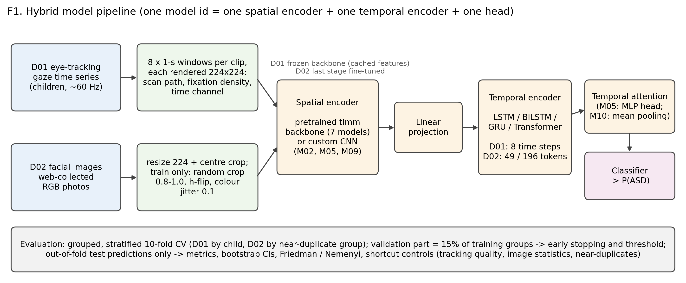

*F1. Hybrid model pipeline*

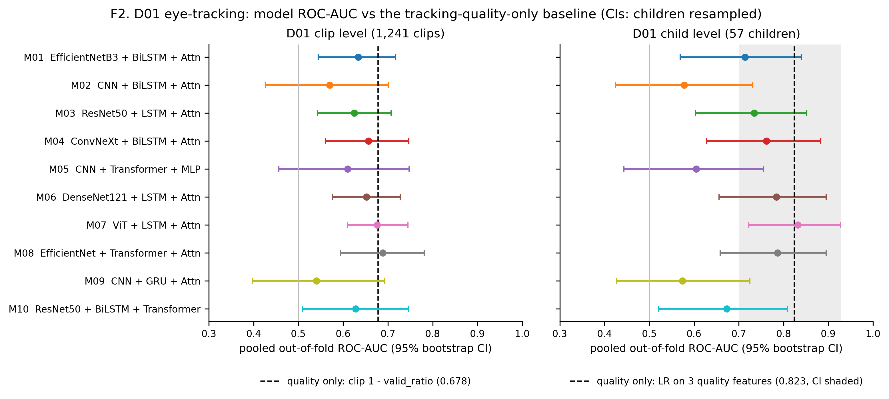

*F2. D01 model ROC-AUC (pooled, 95% CI) vs the tracking-quality baseline, clip and child level*

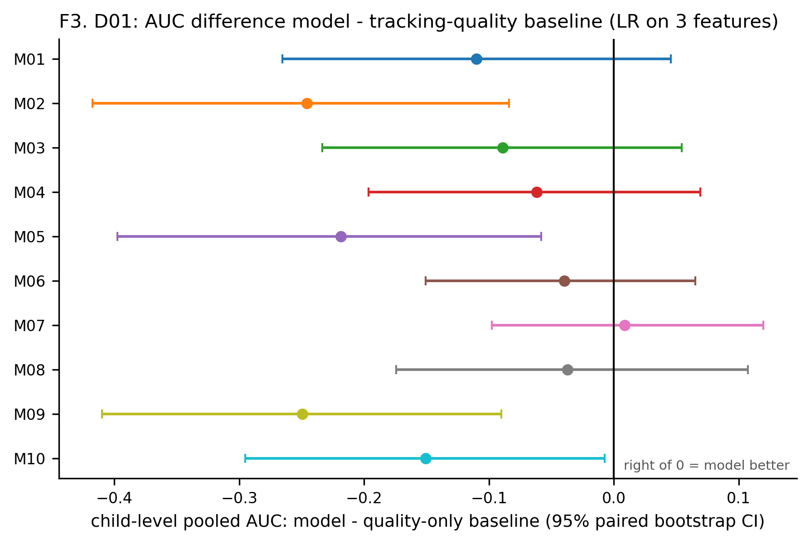

*F3. D01 AUC difference model - quality-only baseline with 95% CIs*

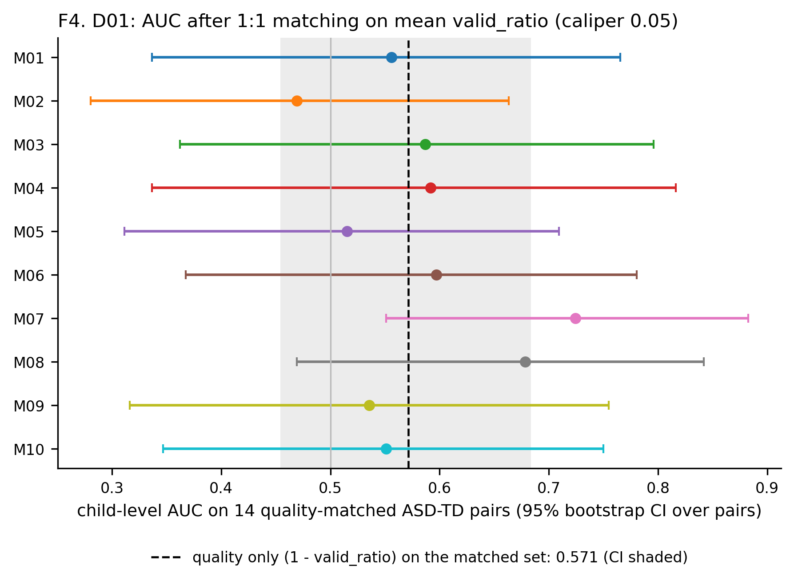

*F4. D01 AUC on quality-matched children*

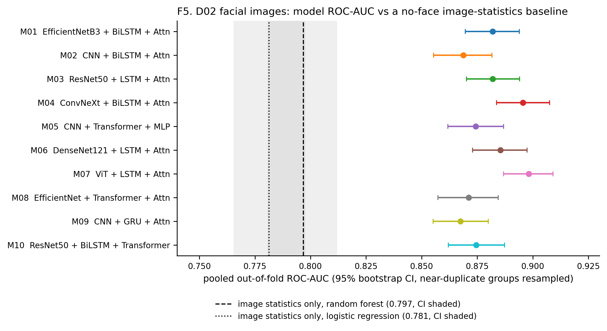

*F5. D02 model ROC-AUC vs the image-statistics baseline*

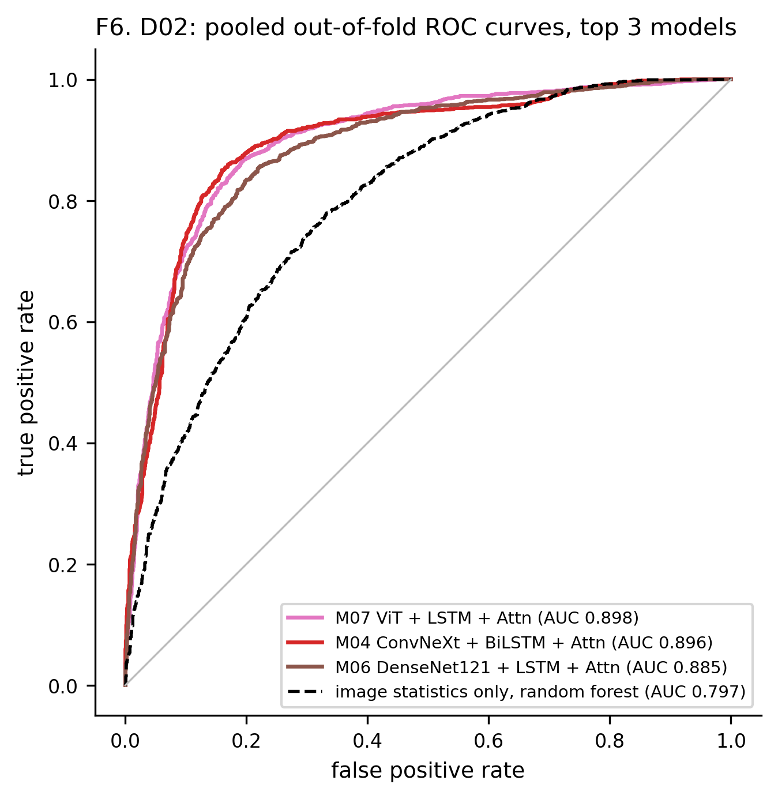

*F6. D02 pooled ROC curves, top 3 models + image-statistics baseline*

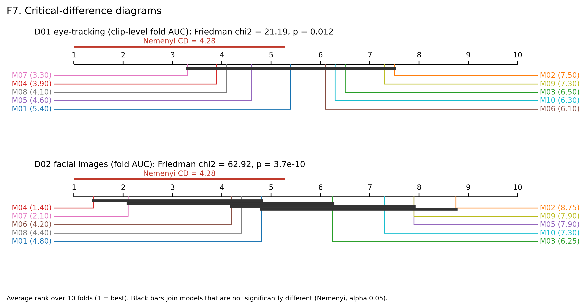

*F7. Critical-difference diagrams, D01 (clip) and D02*

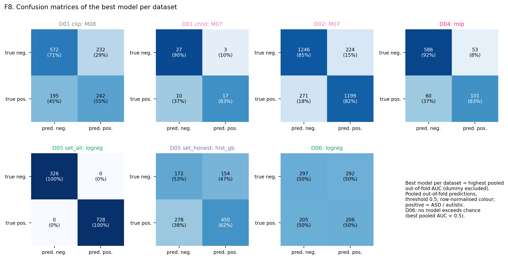

*F8. Confusion matrices of the best model per dataset*

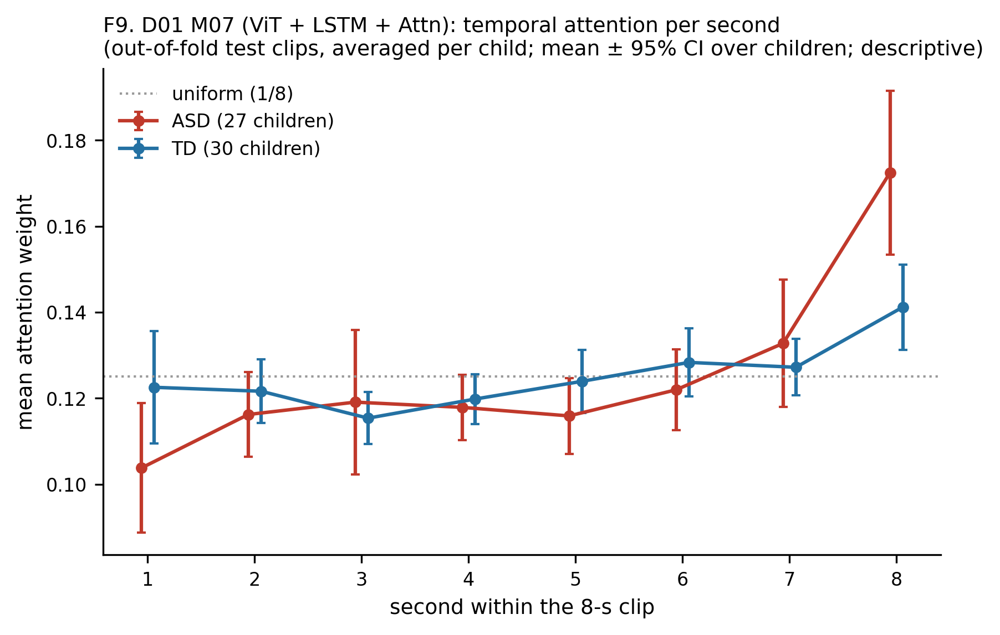

*F9. D01 M07 attention per second, ASD vs TD (descriptive)*

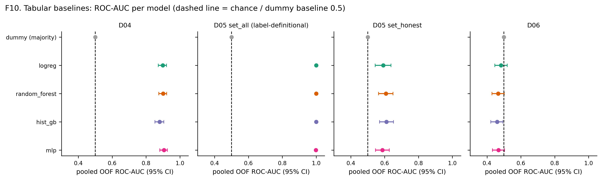

*F10. Tabular baselines: AUC per model*

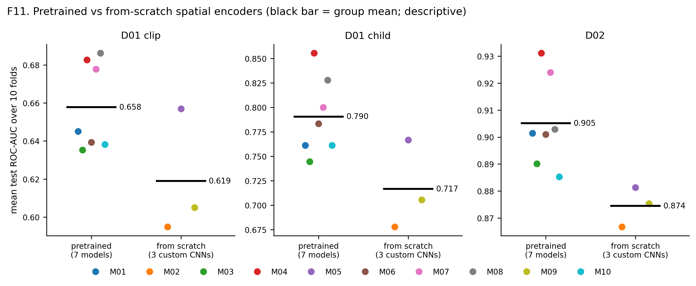

*F11. Pretrained vs from-scratch spatial encoders*

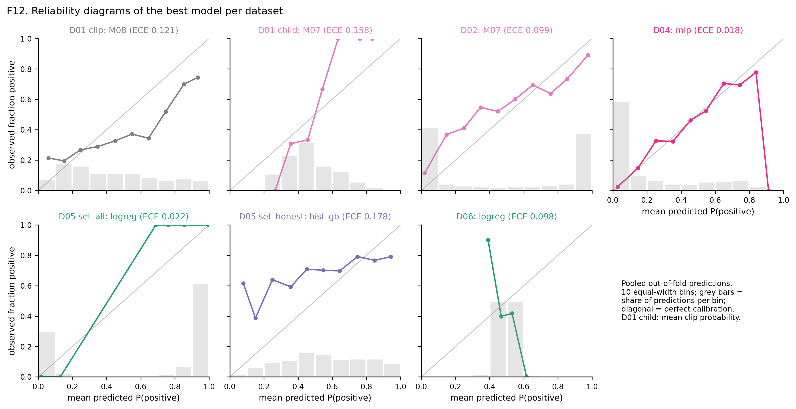

*F12. Reliability diagrams of the best model per dataset*

